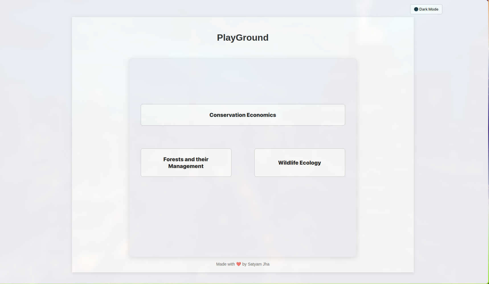
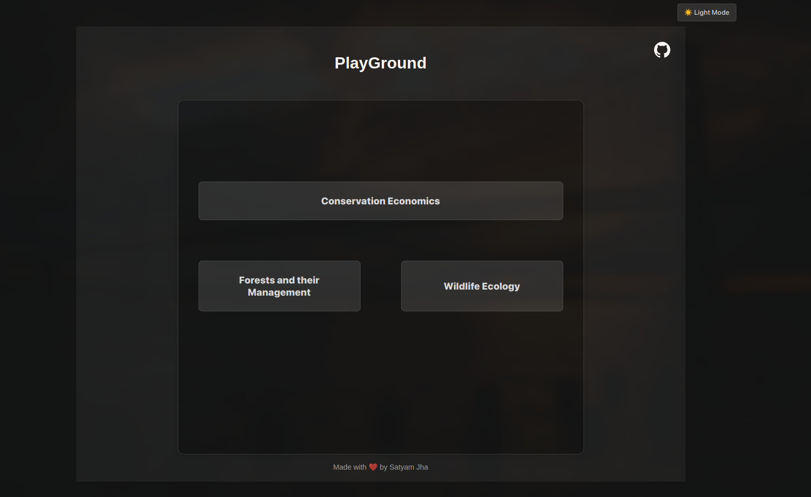
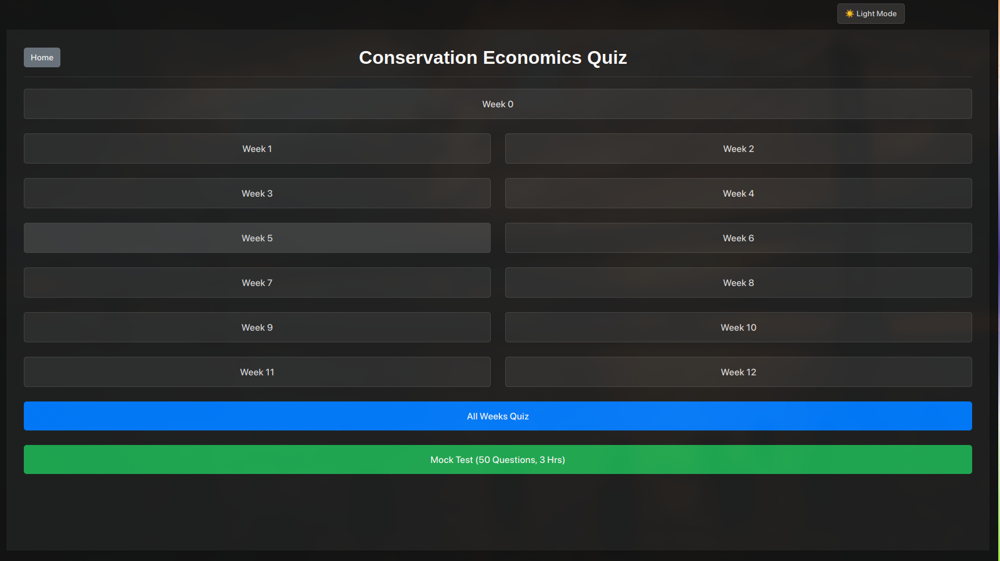
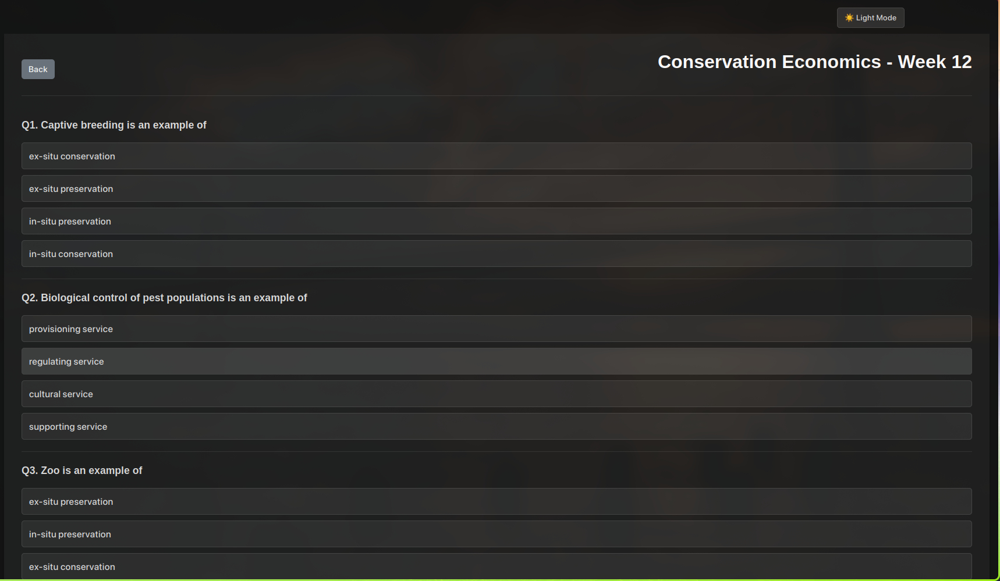
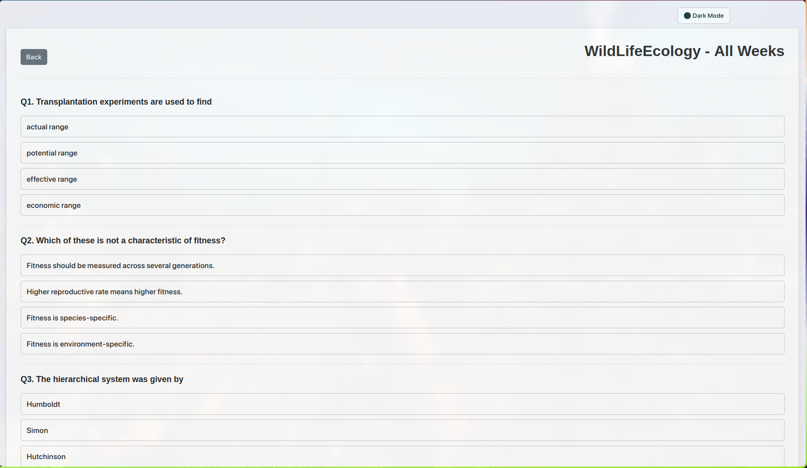
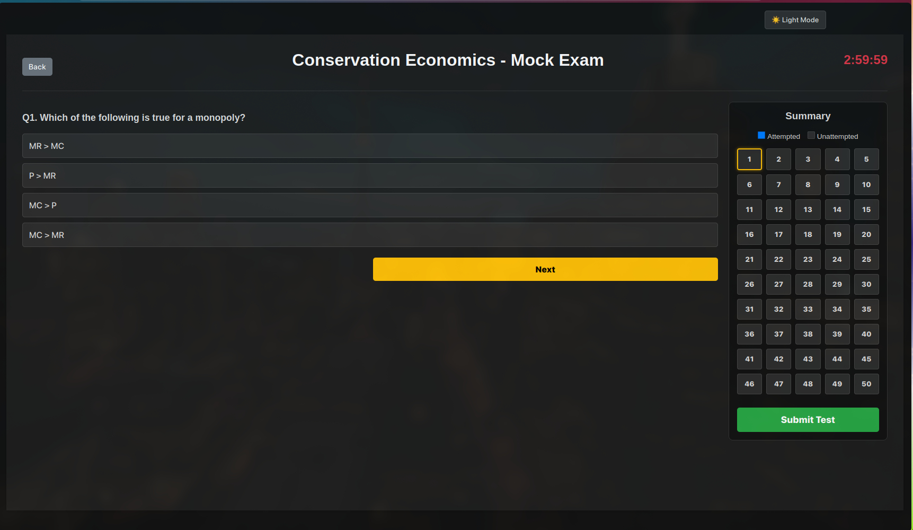

# 🎓 NPTEL Course Quiz Portal

A dynamic, interactive, and fully responsive web-based quiz application designed to help students prepare for NPTEL examinations.

---

## ✨ Features

* **📚 Multi-Course Support:** Currently hosts comprehensive question banks for:
    * Conservation Economics
    * Forests and their Management
    * WildLife Ecology
* **🎯 Advanced Testing Modes:**
    * **Weekly Practice:** Target specific weeks to review granular course material.
    * **All Weeks Review:** A continuous scroll of all available questions for comprehensive revision.
    * **Mock Exam Mode:** Simulates the real NPTEL exam environment with a randomized selection of 50 questions and a strict 3-hour countdown timer.
* **🎨 Seamless UI/UX:**
    * **Dark/Light Mode:** Integrated theme toggling with `localStorage` memory to save user preferences across sessions.
    * **Interactive Question Palette:** A visual grid (in Mock Mode) that tracks progress, highlighting attempted and current questions in real-time.
    * **Instant Feedback:** Post-submission dashboard detailing the final score, time taken, accuracy percentage, and a full breakdown of correct vs. incorrect answers.
* **📱 Fully Responsive:** Adaptive layout utilizing CSS Grid and Flexbox to ensure a flawless experience on desktop, tablet, and mobile devices.

---

## 🛠️ Tech Stack

This project is built purely with frontend technologies, ensuring lightning-fast performance with zero backend dependencies.

* **HTML5:** Semantic structuring and accessible layout design.
* **CSS3:** Custom properties (variables) for theme management, Flexbox & Grid for advanced alignments, and media queries for mobile responsiveness.
* **JavaScript (ES6+):** * Dynamic DOM manipulation and event handling.
    * State management for user scores, timer, and question tracking.

---

### Snapshots of the Web-Application

| Screenshot 1 | Screenshot 2 |
| :---: | :---: |
|  |  |
|  |  |
|  |  |

---

## 💡 What Makes This Project Unique?

1.  **Scalable Data Architecture:** The question bank is isolated into a single, highly structured JSON-like object (`questions.js`). Adding a new course or hundreds of new questions takes seconds and requires **zero changes to the UI code**.
2.  **Stateful Front-End:** The application mimics a state-managed framework (like React) using pure Vanilla JS. It actively tracks an array of user answers, shuffling states, and timer countdowns strictly in the client's browser.

---
